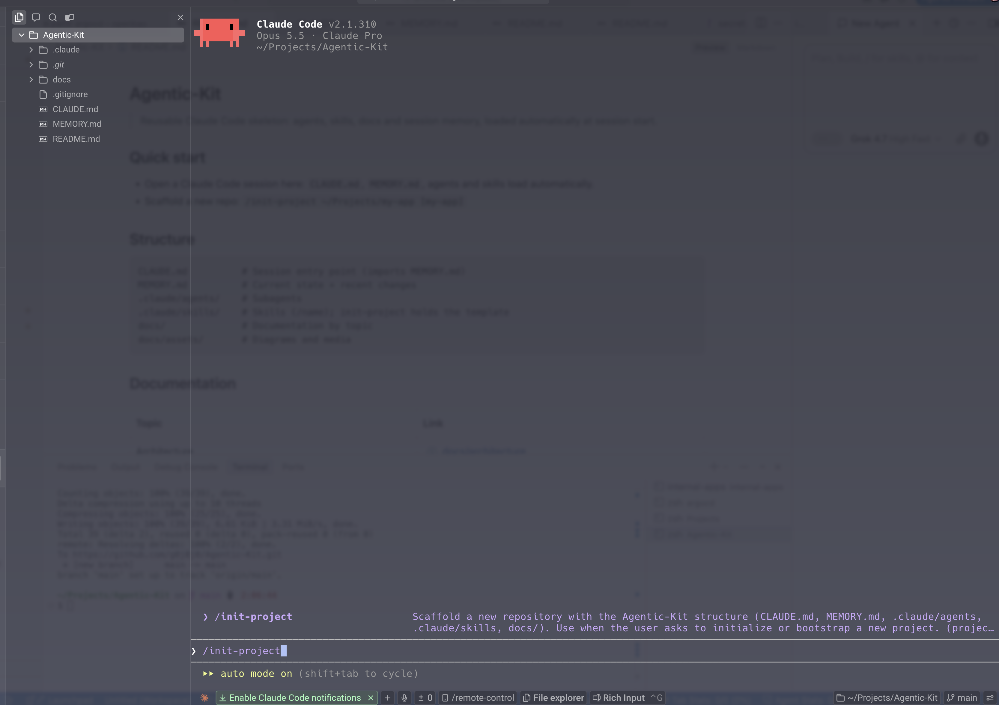
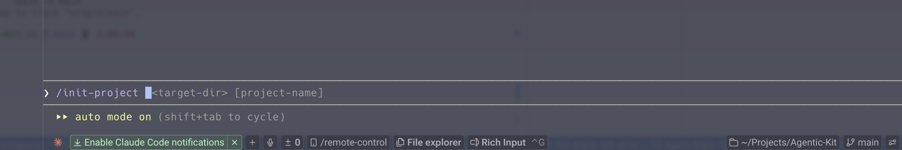

# Skills

Skills live in `.claude/skills/<name>/SKILL.md` and are invoked as `/<name>`.

| Skill | Usage | Purpose |
|---|---|---|
| `init-project` | `/init-project <dir> [name]` | Scaffolds a repo with this structure. Template: `.claude/skills/init-project/template/` (`*.tmpl`, `dot-` → `.`). Kit-only: not copied into generated repos. |

## `/init-project` usage
1. Type `/init-project`: the skill appears in autocomplete with its description.

   

2. Select it, then pass `<target-dir> [project-name]` as shown by the argument hint.

   
